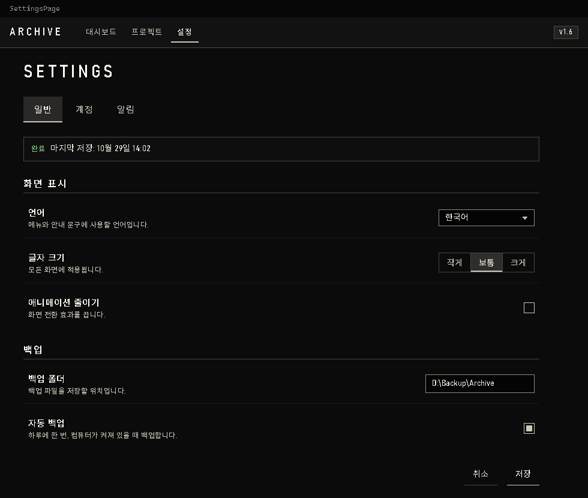

# Skald

Skald is a dark UI design kit that makes a mod's interface look like Skyrim's own menus: smoky near-black backgrounds, thin pale 1px lines, square corners, wide-spaced capital titles, quiet colours, and knotwork corner ornaments.

It was made for the spell panel of the Skyrim mod Heart of Magic (by Iwillbewarlock). It is for Skyrim mod authors (and anyone) who want this look, especially people who use an AI assistant (ChatGPT, Codex, Claude, Gemini, Copilot) to write their mod's UI. For the Korean guide, see `README.ko.md`.

## How to use

### With an AI assistant

1. Give the folder (or the zip) to your AI assistant.
2. Ask it to read `SKALD.md` and apply Skald to your UI file; ask it to change only the look, not text, behaviour or IDs.
3. Open `demo.html` in a browser to compare with the intended look.

Example prompt:

> Read SKALD.md in the attached Skald kit to the end, then apply the Skald design to [your UI file] following its rules. Change only the look: keep all text, behaviour and IDs. When done, go through the 'Before you finish' list in SKALD.md and tell me what I still need to check in game.

### Without AI

Link `skald-tokens.css` then `skald.css` after your own stylesheets, add the class `sk-root` to the outer element, and use the `sk-*` classes. `SKALD.md` describes everything.

## Compatibility

- **HTML/CSS UIs**: Works fully for PrismaUI and other Ultralight-based in-game UIs, web pages, and launchers.
- **Scaleform/SkyUI (Flash) and Qt (MO2 plugins)**: Only the values in `skald-tokens.json` (colours, sizes) can be used, by hand.

## Components and accessibility

Components: buttons, segmented toggle, text fields, select, checkbox, radio, tabs, top bar, setting rows, table, badge, notice, progress bar, dialog, tooltip, and panel with corner ornaments.

Accessibility: all text colours have at least 4.5:1 contrast on every Skald background, status is shown with words (not colour alone), and controls have a visible 2px keyboard focus ring.

## Files

- `SKALD.md` — instructions for AI assistants and people
- `README.ko.md` — Korean guide
- `skald-tokens.css` — all values as CSS variables
- `skald.css` — component classes
- `skald-tokens.json` — values as data
- `assets/corner.png` and `assets/empty.png` — ornaments (`empty.png` is Heart of Magic specific)
- `demo.html` — every component on one page
- `preview.png` — screenshot

## Notes

- Dark theme only.
- Font: Windows' built-in Bahnschrift; no font file is included.
- Not yet checked inside the game (Ultralight): fonts and some form controls. `SKALD.md` lists what to check.
- The interface icons in Heart of Magic (game-icons.net, CC BY 3.0) are not part of this kit.

## Licence

Creative Commons Attribution 4.0 International (CC BY 4.0), see `LICENSE`. You may use, change and share it, including in paid or commercial mods, as long as you credit it.

Suggested credit line:

> Skald UI design by Iwillbewarlock (Heart of Magic), CC BY 4.0
